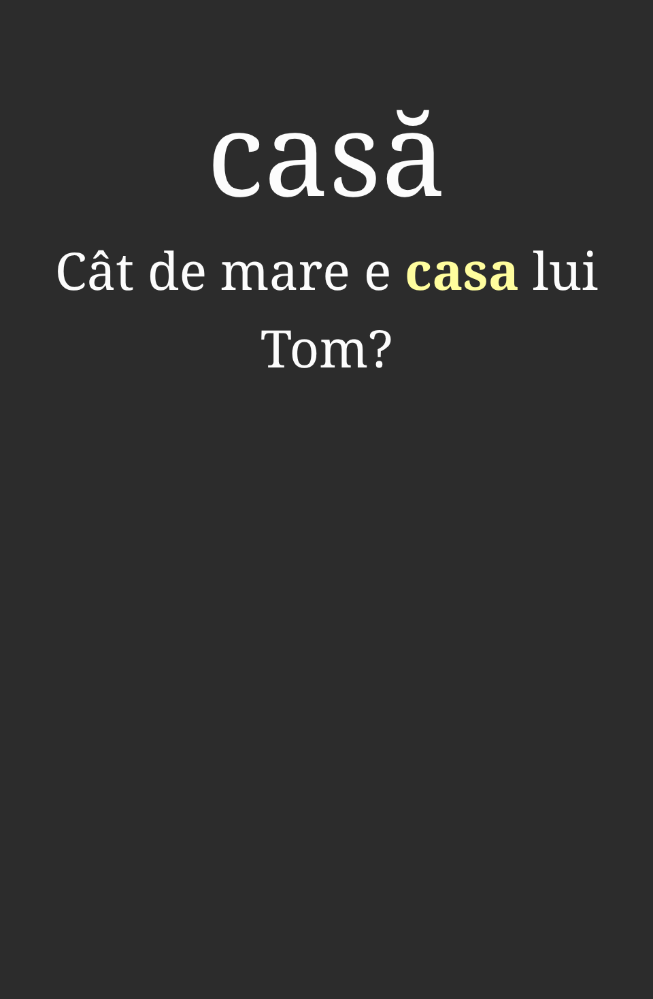
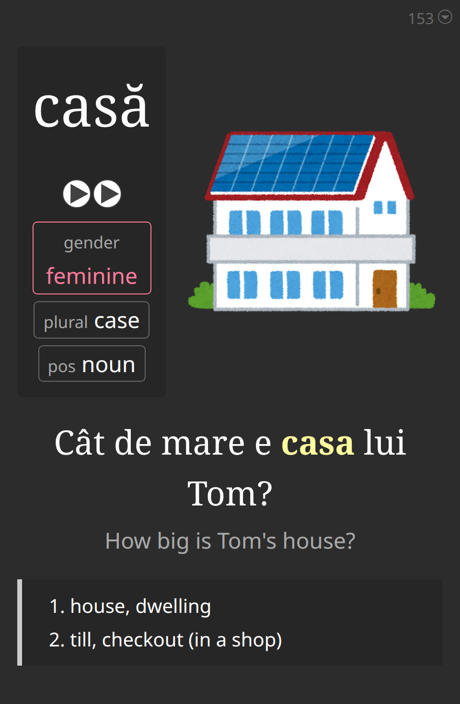

<h1 align="center">Început 1.5k</h1>

A Romanian core deck for Anki: 1500 common words in frequency order, each in a Romanian sentence, with audio and a picture.

Please leave a ⭐ star if Început helped you - it helps others find it :).

 

## Installation

### Requirements

- **Anki** 23.10 or later

1. Download `inceput.apkg` from the [latest release](https://github.com/0xzerolight/inceput/releases/latest).
2. In Anki, choose **File** -> **Import** and pick the file.

This adds the **Început 1.5k** deck and its note type, **Anki Miner Note (Început)**, a copy of [Anki Miner Note](https://github.com/0xzerolight/anki_miner_note). Other note types, an installed Anki Miner Note included, are left as they are. New cards come in study order.

### Updating

Import the new `inceput.apkg` the same way, leaving **Update notes** and **Update note types** at **If newer**.

- Notes the release changed are updated in place and keep their review history.
- New words arrive as new cards.
- A release that changes the card design updates Anki Miner Note (Început). Edits you made to its styling are replaced, so copy them first.
- Words a release drops stay in your collection. Delete them in **Browse** if you want them gone.

An update can overwrite a field you edited on a note that the release also changed.

## Features

- 1500 words in frequency order, one card each: the word on the front, with a Romanian sentence below it.
- The sentence's English translation and one to three English meanings of the word.
- Gender and plural for nouns, and the first-person present and past participle for verbs.
- Native recordings of 1130 words from Lingua Libre and Wikimedia Commons. Synthetic speech in one voice for the other 370 words and every sentence.
- A picture from [いらすとや](https://www.irasutoya.com) on every card.
- Weekdays, months and seasons as blocks in calendar order.
- In 88% of cards, the word is the only new word in its sentence (i+1).

## Troubleshooting

| Issue | Solution |
|---|---|
| New cards come in random order | In the deck's options, set **Display Order** -> **New card sort order** to **Order gathered**. |
| No audio plays | In the deck's options, untick **Audio** -> **Don't play audio automatically**. Press **R** to replay. |

## Contributing

Contributions of any kind are welcome. If you want to support the deck, please share it with others who may benefit from it.

- Card problems and suggestions -> [Issues](https://github.com/0xzerolight/inceput/issues/new/choose).
- Questions and discussion -> [Discussions](https://github.com/0xzerolight/inceput/discussions) or [Discord](https://discord.com/invite/aDtQyZzUVP).

## Acknowledgements

- [Kaishi 1.5k](https://github.com/donkuri/kaishi) - the inspiration for this deck.
- [Lapis](https://github.com/donkuri/lapis) - the card design, through Anki Miner Note.
- [いらすとや](https://www.irasutoya.com), [Tatoeba](https://tatoeba.org), [Wiktionary](https://en.wiktionary.org), [Lingua Libre](https://lingualibre.org) and the other sources in [ATTRIBUTION.md](ATTRIBUTION.md).

## Licence

- **Deck content** - [CC BY-SA 4.0](LICENSE): the word list, sentences, translations, meanings and grammar.
- **Pictures** - used under Irasutoya's terms, so the deck must stay free.
- **Audio** - each file keeps its own licence.
- **Note type** - GNU General Public License v3.0 only, from [Anki Miner Note](https://github.com/0xzerolight/anki_miner_note).

Every source and its licence is listed in [ATTRIBUTION.md](ATTRIBUTION.md).
